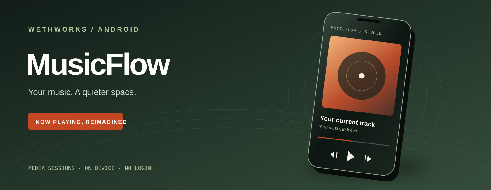

<p align="center"></p>

# WETHWORKS / MusicFlow

> An on-device Android music display. The artwork above is an illustration, not a screenshot.

[Download the Android preview](https://github.com/RyWethxss/MusicFlow/releases) · [Build it yourself](#build) · [Privacy](PRIVACY.md)

MusicFlow turns an Android phone into a calm, live display for the music already playing on the device. It follows Android media sessions, so it works with Spotify and other compatible music apps without asking for a Spotify login.

**Built to be understood.** MusicFlow is part of the WETHWORKS identity. See [`brand/BRAND.md`](brand/BRAND.md) and [`brand/tokens.css`](brand/tokens.css).

Read the [Privacy Notice](PRIVACY.md) for the app's media access and on-device data handling.

## What it does

- Shows the active track, artist, album, source app, and available cover art.
- Sends play, pause, previous, next, and seek actions to the active media session.
- Offers Studio, Ambient, and Lock View display modes.
- Keeps the screen on and dims it in Ambient mode while MusicFlow remains open.
- Stores the selected display mode on the device.

## Android behavior

MusicFlow needs Android's **Notification access** special permission to discover active media sessions. It uses session metadata and transport controls; the app does not read or store notification text. The permission is granted or revoked in Android Settings, not inside MusicFlow.

Lock View lets the already-open MusicFlow activity appear over the keyguard on supported Android versions. Android still owns the system lock screen and decides when the display wakes. MusicFlow cannot replace the lock screen, wake a screen that is off, or provide a system Always-On Display. While the screen is off, Android's own media notification and controls remain available when the music app provides them.

Ambient mode keeps the display awake only while MusicFlow is in the foreground. On-device battery use and lock-screen behavior depend on the phone manufacturer and Android version.

## Build

Requirements: JDK 17, Android SDK Platform 35, and the included Gradle Wrapper (Gradle 8.13).

```bash
./gradlew :app:assembleDebug
```

The installable preview APK is written to `app/build/outputs/apk/debug/app-debug.apk`. This is a debug-signed sideload build, not a Google Play release. The project does not include a private release signing key.

## Install and connect a phone

1. Install the APK and open MusicFlow.
2. Tap **Open Notification Access** and enable MusicFlow in Android Settings.
3. Start music in Spotify or another compatible player and return to MusicFlow.
4. Use the transport controls to control the active session.

For USB installation from a development computer, enable USB debugging, connect the phone, and approve Android's computer authorization prompt. Then use Android Studio's Run button or `adb install -r app/build/outputs/apk/debug/app-debug.apk`.

After building, run `./scripts/install-phone.sh` to install the APK on the only connected, authorized device. Pass an ADB serial when more than one device is connected: `./scripts/install-phone.sh SERIAL`.

## Project setup

- Android Gradle Plugin: 8.13.2
- Kotlin: 2.0.21
- Gradle Wrapper: 8.13
- Compile/target SDK: 35
- Minimum Android version: Android 8.0 (API 26)
- Application ID: `dev.musicflow.app`

This preview is debug-signed and is intended for sideloading and evaluation. The GitHub Actions workflow also builds a debug APK artifact when run.
